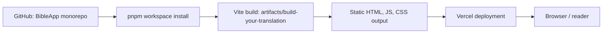
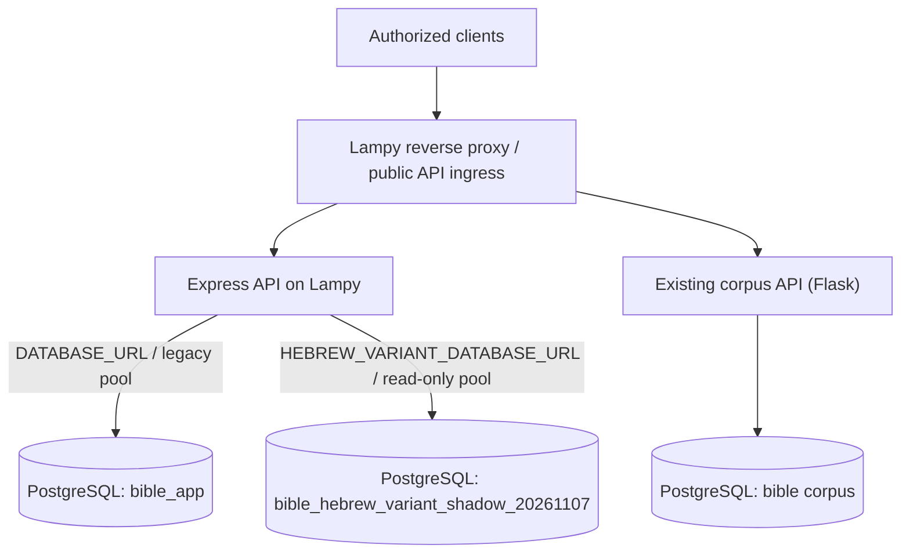
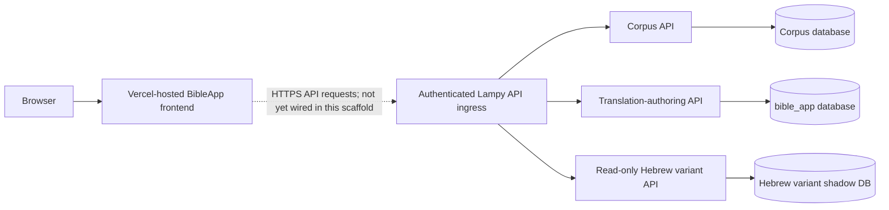

# BibleApp — Architecture and Runtime Boundary

**Status date:** 2026-11-08  
**Repository:** `kitcosby/BibleApp`  
**Observed main commit:** `ac66891d346104dc33845e22c80c883e5a58fa6b`

This document distinguishes the Replit/Vercel scaffold from the operational BibleApp services. A successful Vercel build proves that the selected frontend package can be built and hosted; it does not prove that the BibleApp experience or its backend dependencies are complete or independently available.

## Executive summary

The Vercel project is a useful frontend scaffold and build/hosting target. It is not a self-contained BibleApp deployment.

As of this status date:

- The Vercel project `build-your-translation` uses Vite and builds the package at `artifacts/build-your-translation`.
- The frontend's current `App.tsx` still renders a placeholder ("Replit Agent is building...") at `/`; it has no Study/Read workflow yet.
- The frontend package builds to static Vite output. The latest deployment is marked `READY`, with a `production` target, but Vercel project metadata reports `live: false`. SSO protection is enabled for all deployments except custom domains. Treat this as a successful build/deployment artifact, not proof of a publicly usable production application.
- The monorepo also contains an Express API server. Vercel's observed build runs the frontend package's Vite build; it does not start the Express server as a running API service.
- The Express API is separately operated on Lampy. It has a legacy `DATABASE_URL` pool for the `bible_app` authoring database and a separate `HEBREW_VARIANT_DATABASE_URL` pool for the isolated read-only Hebrew-variant shadow database.
- The existing Bible corpus/API service and BibleApp PWA remain separate from this Vercel scaffold. The PWA already consumes Lampy-hosted services; the Vercel frontend has not yet been wired to replace or duplicate that working experience.

**Architectural rule:** Vercel may host the browser application, but Lampy remains the authoritative host for corpus data and the existing backend services. Do not copy production corpus data or Lampy database credentials into Vercel.

## Runtime and repository inventory

| Component | Location / runtime | Current role | Status |
|---|---|---|---|
| Vercel frontend project | Vercel project `build-your-translation`; Vite | Builds and hosts the monorepo's frontend package | Latest observed deployment READY; app itself remains placeholder |
| Frontend source | `artifacts/build-your-translation` | React + Vite + Wouter UI | Scaffold; no Study/Read experience in current `App.tsx` |
| Shared API client | `lib/api-client-react`, generated from `lib/api-spec` | Typed client/hooks and schemas | Exists; its existence does not mean the frontend currently calls Lampy |
| Express API | `artifacts/api-server` | Health, translation-authoring, and Hebrew-variant routes | Separately run on Lampy; not hosted by the observed Vercel Vite build |
| Legacy authoring DB pool | `lib/db/src/index.ts`, `DATABASE_URL` | Existing `bible_app` authoring tables | Keep separate from corpus and Hebrew-variant DB connections |
| Hebrew variant DB pool | `artifacts/api-server/src/lib/hebrew-variant-db.ts`, `HEBREW_VARIANT_DATABASE_URL` | Read-only access to `bible_hebrew_variant_shadow_20261107` | Dedicated pool, max 5, read-only transaction default |
| Corpus API / database | Lampy; existing Flask service and PostgreSQL `bible` | Authoritative corpus, morphology, alignments, search and verse data | Existing operational backend; not replaced by the Vercel scaffold |
| BibleApp PWA | `kitcosby/BibleApp-pwa`; Vercel + Lampy API | Existing user-facing Study/Read app | Separate frontend and release path |
| Mockup sandbox | `artifacts/mockup-sandbox` | Design exploration | Not the production BibleApp frontend |

## Current request/data flows

### What is deployed by the observed Vercel project

The latest successful Vercel build log shows the frontend package's Vite build and static output. It does not show an Express API process being started. The Vercel project is therefore currently a static frontend hosting path.

### Existing Lampy backend boundary

This diagram records the intended/current service separation, not a claim that Vercel is already integrated with every route. PostgreSQL remains localhost-bound on Lampy; it must not be exposed directly to Vercel or browsers.

### Intended frontend integration

The dotted connection is deliberate: the frontend's current `App.tsx` is a placeholder and does not yet implement this integration.

## API and database boundaries

### Express API

- Express application mounts its router under `/api`.
- API server entry point requires `PORT` and listens on `127.0.0.1`; the current Lampy deployment is a separate long-running service behind the Lampy ingress.
- `/api/healthz` is the application health route.
- `/api/bible/*` contains translation-authoring routes. Mutating operations require `BIBLE_APP_SANDBOX_TOKEN`; the legacy DB pool is imported from `@workspace/db`.
- `/api/lexicon/hebrew-vowel-variants/*` is mounted separately and uses its own explicit sandbox-token authorization and dedicated read-only pool.
- The Hebrew variant pool reads `HEBREW_VARIANT_DATABASE_URL`, has a maximum of five connections, bounded connection/query timeouts, and PostgreSQL read-only transaction defaults. It must not be conflated with `DATABASE_URL`.

### Database ownership

| Database | Authority / purpose | Connection boundary |
|---|---|---|
| `bible` | Canonical corpus and linguistic data | Lampy corpus service; do not connect from the Vercel frontend |
| `bible_app` | Existing translation-authoring data | Express legacy pool via `DATABASE_URL` |
| `bible_hebrew_variant_shadow_20261107` | Validated Hebrew vowel-variant shadow tables | Express dedicated pool via `HEBREW_VARIANT_DATABASE_URL`; read-only |

Never put database URLs, passwords, sandbox tokens, or other secrets in Git, frontend build variables, browser bundles, project documentation, or logs. Browser code may receive only public API base URLs and appropriately scoped short-lived/user credentials where designed.

## Vercel deployment observations

Observed project metadata and build events on 2026-11-08:

- Project: `build-your-translation`; framework: `vite`; Node version setting: `26.x`.
- Project ID: `prj_asT5ibCszaL5hgvZBhN3DdcotAnk`; team-owned.
- Latest deployment: `dpl_HT24LL9GQUcdkyB9b6RNuajFd7Tj`; state `READY`; target `production`; source commit `ac66891` on `main`.
- Project metadata simultaneously reports `live: false`. The deployment target and project live flag are not equivalent; verify domain behavior and an authenticated browser session before calling the app live.
- SSO protection is enabled for all deployments except custom domains. Do not create a shareable deployment link merely to bypass SSO without explicit approval.
- A preceding deployment from commit `4e754bd` failed during dependency installation because `pnpm-lock.yaml` lacked the `@replit/connectors-sdk@0.4.3` record. The lockfile was restored in PR #4; a later main deployment completed dependency installation and the Vite build successfully.
- The successful build emits `artifacts/build-your-translation/dist/public` static assets. It does not establish runtime connectivity to Lampy.

## Verified gaps before this becomes BibleApp

1. **Replace the placeholder UI.** Implement the actual Study and Read flows, navigation, verse selection, interlinear presentation, and user translation controls.
2. **Choose the frontend's canonical API contract.** Use the existing Lampy APIs where appropriate; do not create a second competing corpus source in Vercel.
3. **Wire the frontend deliberately.** Configure a public API base URL and secure user/session authorization. Do not embed `BIBLE_APP_SANDBOX_TOKEN` or database credentials in Vite environment variables.
4. **Resolve browser-to-Lampy connectivity.** Confirm HTTPS ingress, CORS policy, authentication, error handling, and browser-compatible API paths from a real browser. Localhost-only database access remains on Lampy.
5. **Keep API runtime deployment separate.** The current Vercel project is configured and observed as a Vite frontend build. If the Express API ever moves to serverless hosting, that is a separate architecture and security review, not an automatic consequence of this build.
6. **Test integration, not just compilation.** Acceptance tests must exercise a browser against the real Lampy API for corpus reads, translation persistence, and Hebrew variant lookups. A green Vite build is necessary but insufficient.
7. **Verify production status.** Resolve the `live: false` / `target: production` metadata discrepancy, inspect custom-domain behavior, and confirm SSO behavior before announcing a public release.

## Release gates

- [ ] Actual Study and Read UI implemented and reviewed.
- [ ] API contract and frontend integration documented.
- [ ] No backend secrets in client bundles or Vercel build logs.
- [ ] Lampy ingress, CORS, and authentication verified from a browser.
- [ ] Corpus, authoring, and Hebrew-variant database boundaries preserved.
- [ ] End-to-end tests pass against Lampy services.
- [ ] Vercel domain and deployment protection reviewed; public/live status verified.
- [ ] Separate approval for any Lampy service restart, database change, production deployment, or data migration.

## Evidence and limitations

This status is grounded in the GitHub main-branch source at `ac66891`, Vercel project/deployment metadata and build events, and the previously live-tested Lampy Hebrew variant API. It is not a claim that the browser has been tested against the SSO-protected Vercel deployment in this session. The current frontend source and deployment logs were inspected; the protected page itself was not opened, and no share link was created.

Update this document when routes, deployment settings, service ownership, or frontend integration change.
