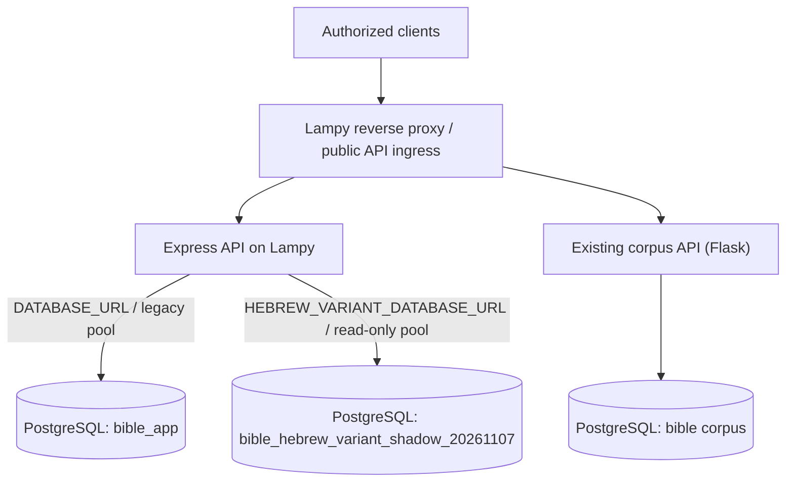
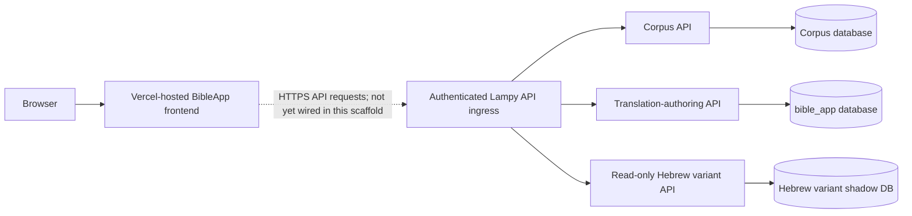
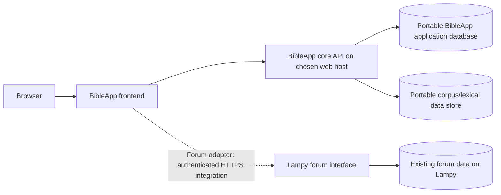

# BibleApp — Architecture and Runtime Boundary

**Status date:** 2026-11-08  
**Repository:** `kitcosby/BibleApp`  
**Observed main commit:** `ac66891d346104dc33845e22c80c883e5a58fa6b`

This document distinguishes the Replit/Vercel scaffold from the operational BibleApp services. A successful Vercel build proves that the selected frontend package can be built and hosted; it does not prove that the BibleApp experience or its backend dependencies are complete or independently available.

## Executive summary

The Vercel project is a useful frontend scaffold and build/hosting target. It is not a self-contained BibleApp deployment.

As of this status date:

- The Vercel project `build-your-translation` uses Vite and builds the package at `artifacts/build-your-translation`.
- The frontend's current `App.tsx` still renders a placeholder ("Replit Agent is building...") at `/`; it has no Study/Read workflow yet.
- The frontend package builds to static Vite output. The latest deployment is marked `READY`, with a `production` target, but Vercel project metadata reports `live: false`. SSO protection is enabled for all deployments except custom domains. Treat this as a successful build/deployment artifact, not proof of a publicly usable production application.
- The monorepo also contains an Express API server. Vercel's observed build runs the frontend package's Vite build; it does not start the Express server as a running API service.
- The Express API is separately operated on Lampy. It has a legacy `DATABASE_URL` pool for the `bible_app` authoring database and a separate `HEBREW_VARIANT_DATABASE_URL` pool for the isolated read-only Hebrew-variant shadow database.
- The existing Bible corpus/API service and BibleApp PWA remain separate from this Vercel scaffold. The PWA already consumes Lampy-hosted services; the Vercel frontend has not yet been wired to replace or duplicate that working experience.

**Target architectural rule (confirmed by Kit, 2026-11-08):** BibleApp's core must be deployable on a web server other than Lampy, with its own portable application/API runtime and database dependencies. The forum/comment system is the deliberate exception: it remains on Lampy, and BibleApp integrates with it through a documented, replaceable forum adapter. Lampy must not remain a hidden dependency for Bible text, lexical data, morphology, alignments, variant lookups, or translation-authoring operations. Vercel is one possible frontend host, not an architectural requirement. Do not expose database credentials or backend secrets to browsers or frontend builds.

## Runtime and repository inventory

| Component | Location / runtime | Current role | Status |
|---|---|---|---|
| Vercel frontend project | Vercel project `build-your-translation`; Vite | Builds and hosts the monorepo's frontend package | Latest observed deployment READY; app itself remains placeholder |
| Frontend source | `artifacts/build-your-translation` | React + Vite + Wouter UI | Scaffold; no Study/Read experience in current `App.tsx` |
| Shared API client | `lib/api-client-react`, generated from `lib/api-spec` | Typed client/hooks and schemas | Exists; its existence does not mean the frontend currently calls Lampy |
| Express API | `artifacts/api-server` | Health, translation-authoring, and Hebrew-variant routes | Separately run on Lampy; not hosted by the observed Vercel Vite build |
| Legacy authoring DB pool | `lib/db/src/index.ts`, `DATABASE_URL` | Existing `bible_app` authoring tables | Keep separate from corpus and Hebrew-variant DB connections |
| Hebrew variant DB pool | `artifacts/api-server/src/lib/hebrew-variant-db.ts`, `HEBREW_VARIANT_DATABASE_URL` | Read-only access to `bible_hebrew_variant_shadow_20261107` | Dedicated pool, max 5, read-only transaction default |
| Corpus API / database | Lampy; existing Flask service and PostgreSQL `bible` | Authoritative corpus, morphology, alignments, search and verse data | Existing operational backend; not replaced by the Vercel scaffold |
| BibleApp PWA | `kitcosby/BibleApp-pwa`; Vercel + Lampy API | Existing user-facing Study/Read app | Separate frontend and release path |
| Mockup sandbox | `artifacts/mockup-sandbox` | Design exploration | Not the production BibleApp frontend |

## Current request/data flows

### What is deployed by the observed Vercel project

The latest successful Vercel build log shows the frontend package's Vite build and static output. It does not show an Express API process being started. The Vercel project is therefore currently a static frontend hosting path.

### Existing Lampy backend boundary

This diagram records the intended/current service separation, not a claim that Vercel is already integrated with every route. PostgreSQL remains localhost-bound on Lampy; it must not be exposed directly to Vercel or browsers.

### Intended frontend integration

The dotted connection is deliberate: the frontend's current `App.tsx` is a placeholder and does not yet implement this integration.

## Confirmed target: portable core with Lampy forum integration

Kit clarified that “standalone” does **not** mean removing every Lampy dependency. The forum/comment section is tied to the existing forum and therefore continues to require Lampy. The rest of BibleApp must be host-portable.

### Target service boundary

The diagram describes the target, not the current deployment. The core API and its data stores must be installable and operable on another web server without reaching Lampy. Only forum/comment features may depend on the Lampy forum interface.

### Portability requirements

1. **Core data independence:** Bible text, morphology, alignments, lexical data, variant data, search indexes, and translation-authoring data required by core features must be served from the chosen BibleApp host or its explicitly configured data services. A core Bible lookup must not silently proxy to Lampy.
2. **Reproducible data provisioning:** Provide versioned schema migrations, reproducible corpus imports/snapshots, integrity checks, and documented backup/restore procedures. Preserve provenance and licensing for every source.
3. **Configuration, not code forks:** Hostnames, database URLs, forum endpoint, and credentials must be environment-configured. No host-specific paths, Lampy IPs, or secrets embedded in frontend code.
4. **Forum adapter:** Isolate forum operations behind a small server-side interface. The browser must not receive forum service secrets. Define supported operations, identity/session handoff, authorization, CORS/CSRF protections, error behavior, and graceful handling when Lampy/forum is unavailable. Do not assume the forum's API capabilities until inspected.
5. **Degraded mode:** If Lampy is unavailable, Bible reading, study, lexical, variant, and translation features should continue. Only forum/comment functions should report unavailable.
6. **Host-neutral deployment:** Document a deployment path for a conventional web server (reverse proxy, frontend assets, core API process, database, TLS, health checks, backups). Vercel may remain a frontend option, but the architecture must not depend on Vercel or Replit-specific services.
7. **Migration safety:** Treat existing Lampy databases and corpus as source-of-truth until a migration plan is validated and explicitly approved. No database cutover, writes, destructive changes, or retirement of existing services are implied by this target decision.

### Implementation sequence

- Inventory every frontend/API request and classify it as core or forum.
- Inspect the actual Lampy forum implementation and identify its supported integration mechanism; do not invent an endpoint or assume a plugin/API exists.
- Define and test the forum adapter contract.
- Make core API services and corpus data portable, with local/staging deployments that do not require Lampy.
- Add a deployment profile for a non-Lampy host and prove core workflows while Lampy/forum access is blocked.
- Test forum integration separately against Lampy, including authentication and failure behavior.
- Only after parity, integrity, backup/restore, and security checks should any production cutover be proposed.

## Observed dependency inventory — 2026-11-08

This inventory was checked against current GitHub source and read-only inspection of the Lampy WSL filesystem. It describes the present implementation, not the desired final deployment.

### Live Lampy routing and services

The active Apache site configuration contains these mappings:

| Public path | Upstream | Application | Target classification |
|---|---|---|---|
| /app | 127.0.0.1:8000 | Custom Flask forum in /opt/forum | **Lampy-only exception** |
| /bible | 127.0.0.1:5057 | Legacy Flask corpus API in /opt/bible/website/app_v2.py | Core; must become portable |
| /api/ | 127.0.0.1:8799 | Express API in /opt/bible-app-api | Core; must become portable |

The forum is not Discourse, phpBB, or Flarum. It is a custom Flask application. Its production run command is documented as Gunicorn bound to localhost port 8000. The /app reverse proxy strips the public prefix before forwarding to the application.

### Forum capabilities and limits

Observed in /opt/forum/app.py, schema.sql, and its templates:

- Server-rendered Flask pages for category listing, category threads, thread detail, thread creation, registration, login/logout, metrics, search, and documentation pages/images.
- PostgreSQL-backed users, categories, threads, posts, forum_events, Timescale continuous aggregate forum_daily, and docs.
- A post belongs to a thread; a thread belongs to a category and author. **The inspected schema has no Bible book/chapter/verse or BibleApp entity foreign key.** Therefore the current forum data model does not itself provide per-verse comment threads.
- Authentication is local to the forum: username/password hashes in users, Flask signed session cookie, and a CSRF token checked on POST. No shared BibleApp identity provider or SSO contract was found in the inspected code.
- No JSON REST API, OAuth/OIDC endpoints, or explicit cross-application session handoff were found in the inspected app.py. Current operations are HTML pages and form submissions.
- Forum registration and reply notifications use SMTP through the configured James mail service. Search currently falls back to PostgreSQL ILIKE; the vector-search function is a placeholder even when a vectorizer is detected.
- Forum config contains credentials/secrets and was intentionally not read or copied into project documentation.

**Implication:** the forum can remain an independently hosted Lampy application, but an embedded BibleApp comments experience requires a new integration surface and an explicit identity decision. A simple iframe or direct browser fetch is not a safe substitute for an authenticated API. A plain link to /app is the only presently evidenced integration behavior.

### Existing BibleApp client dependencies

| Client / package | Current dependency | What it consumes | Portability work |
|---|---|---|---|
| Existing PWA kitcosby/BibleApp-pwa | Static shell currently served from Lampy /byot/; read-only corpus API on Lampy | GET books, chapters, verses, verse, chapter, word, search; browser localStorage stores rendering and witness choices | Move static hosting to selected host; move/provision corpus API and data; replace hard-coded Lampy API fallback bases with configuration |
| Vercel monorepo frontend artifacts/build-your-translation | Vite static build | Currently placeholder only; no Study/Read or forum integration | Implement actual core UI and API client; make API base configurable |
| Express API artifacts/api-server | Lampy process on localhost 8799 | Health; translation authoring against bible_app; Hebrew variant reads against the isolated shadow DB | Package as host-neutral service; provision target DBs and environment; replace sandbox-token gate with reviewed user authentication before public release |
| Flask corpus API /bible | Lampy process on localhost 5057 | Canonical corpus, verse/word payloads, search, alignments and variant witnesses | Port this service or replace it with a behavior-compatible implementation; migrate corpus and search data with provenance/integrity checks |
| Flask forum /app | Lampy process on localhost 8000 | Forum users, categories, threads, posts, docs, events | Leave on Lampy; expose a deliberately designed integration contract only if comments are embedded in BibleApp |

The PWA architecture document confirms its current API_BASES probe order includes the public Lampy Funnel, the Lampy tailnet URL, and same-host /bible. These all target the same Lampy corpus service. Moving only the static PWA files would therefore **not** make the app independent of Lampy.

### Express API and database split

Observed in the monorepo source:

- GET /api/healthz is a process health route.
- /api/bible/* translation-authoring routes use the legacy DATABASE_URL pool from lib/db and the pre-existing bible_app schema.
- /api/lexicon/hebrew-vowel-variants/* uses a separate HEBREW_VARIANT_DATABASE_URL pool to the validated Hebrew-variant shadow database. It is read-only, max five connections, with bounded timeouts and read-only transaction defaults.
- The API currently uses a sandbox-token gate, not production user authentication. Do not expose this service publicly until identity, per-user authorization, ownership enforcement, and security review are complete.
- The Express API does **not** currently replace the Flask corpus API. Treating it as the only backend would omit the core read/search routes used by the existing PWA.

### Additional legacy Flask application responsibilities

Read-only inspection of /opt/bible/website/app_v2.py found that the /bible service is more than a read-only corpus API:

- It serves legacy HTML Bible/interlinear/reading pages and routes for signup/login/logout, translation selection and creation, per-word choices, reading-position persistence, exports, and variant browsing.
- It exposes the read-only JSON endpoints consumed by BibleApp-pwa: /api/books, /api/chapters/{book}, /api/verses/{book}/{chapter}, /api/verse/{book}/{chapter}/{verse}, /api/chapter/{book}/{chapter}, /api/word/{strongs}, and /api/search.
- The JSON API currently sets Access-Control-Allow-Origin: * and returns public corpus data. The frontend's existing API fallback URLs all lead to this same Lampy service.
- Search calls Ollama at 127.0.0.1:11434 using nomic-embed-text to embed the query, then performs vector similarity against the corpus database's ylt_verses_embedding_store. Therefore moving the Flask API and PostgreSQL data alone is insufficient: the query-embedding runtime/model must also move, or search must be redesigned and equivalence-tested.
- The legacy Flask UI uses its own account/session flow backed by user_accounts and stores signed-in reading positions in reading_position. Its authoring operations use the shared translation, word_choice, other_option, and lemma_default tables in bible_app.
- The newer Express API also reads/writes translation-authoring tables in bible_app. This means there are two active application surfaces touching overlapping authoring data. Any replacement or cutover must define one canonical write API, maintain compatibility during transition, and test concurrent update behavior. Do not remove legacy routes based on the existence of the Express API.

### Identity and authoring ownership are not yet unified

Three separate identity mechanisms are visible in the inspected source:

1. Legacy Bible site: Flask sessions backed by bible_app.user_accounts.
2. Forum: separate Flask sessions backed by forum.users.
3. Express authoring/variant API: sandbox-token gate; no end-user identity/session integration in the inspected routes.

No SSO or account-linking contract was found. The schema and code should not be treated as proof that a Bible site account and a forum account represent the same person. A production architecture must explicitly decide whether to link existing accounts, adopt an identity provider, or retain separate forum login. It must also enforce translation ownership server-side; a sandbox token is not an end-user authorization model.

### Search migration: pending word-variant embedding rebuild

Kit clarified on 2026-11-08 that search functionality will be retooled after the current embedding rebuild completes (estimated approximately four additional hours at the time of the update). Do not treat the existing Ollama-backed YLT verse search as the target design, and do not spend migration effort making that implementation permanent.

Important distinction between the two embedding datasets:

- Existing verse-semantic search data: 31,102 YLT verse embeddings in `ylt_verses_embedding_store`. The current Flask `/api/search` route generates a query embedding through local Ollama (`nomic-embed-text`) and searches this store. This feature is separate from the new rebuild.
- Rebuilding dataset: 528,565 embeddings keyed to the existing `word_variant` rows. The rebuild is isolated on the laptop in a separate database and reads the corpus source read-only. The recorded reconstruction embeds each variant's `letters` form. The exact original input string was not recovered, so this is a documented reconstruction, not proof of bit-for-bit reproduction of a lost prior embedding run. The reported embedding blob size is 3,072 bytes.

Completion gates for the rebuild:
1. Exactly 528,565 expected variant keys accounted for, with no missing or duplicate keys.
2. Every embedding blob has the expected 3,072-byte size and agrees with the documented vector dimensionality/encoding.
3. Representative rows and source-to-embedding key associations spot-checked.
4. Failures, exclusions, and any reconstructed-input assumptions explicitly reported.
5. Exported off the laptop and restored/verified independently before considering production use.
6. No writes to the live application or production corpus during the isolated build.

The intended search modes, query normalization, language handling, ranking strategy, production destination, and API/UI contract for these word-variant embeddings have **not yet been specified or approved**. Do not infer that the new vectors should replace verse search, nor assume that embedding each `letters` form automatically provides useful Hebrew/Greek semantic search. After validation, design and evaluate the search experience against actual user tasks and a representative test set. Keep the old verse-search path available until a replacement is validated; do not silently switch production search.

For portability planning, classify the current local Ollama query-embedding call as a **temporary legacy dependency**. The final search design must explicitly specify where query embeddings are generated and how that runtime/model is provisioned on the non-Lampy host. This decision is open pending completion and validation of the new dataset and search design.

### Portability acceptance tests

A non-Lampy staging deployment is not portable until all of these pass with Lampy network access blocked, except for the deliberately excluded forum path:

1. Load books, chapters, verses, verse details, word details, search results, morphology, translation phrases, and witness/variant data.
2. Load Hebrew vowel-variant group and occurrence details from the target host's validated dataset.
3. Read and persist translation-authoring choices with real user identity and ownership checks.
4. Start, restart, back up, and restore the core services and databases using only documented host configuration.
5. Confirm the frontend has no hard-coded Lampy hostnames, IPs, Funnel URLs, or Lampy-only fallback behavior for core requests.
6. Disable Lampy/forum access and verify all core study and reading functions still work.
7. Separately test the forum integration, including unauthenticated state, signed-in state, CSRF protection, session expiry, logout, and Lampy/forum outage behavior.

## API and database boundaries

### Express API

- Express application mounts its router under `/api`.
- API server entry point requires `PORT` and listens on `127.0.0.1`; the current Lampy deployment is a separate long-running service behind the Lampy ingress.
- `/api/healthz` is the application health route.
- `/api/bible/*` contains translation-authoring routes. Mutating operations require `BIBLE_APP_SANDBOX_TOKEN`; the legacy DB pool is imported from `@workspace/db`.
- `/api/lexicon/hebrew-vowel-variants/*` is mounted separately and uses its own explicit sandbox-token authorization and dedicated read-only pool.
- The Hebrew variant pool reads `HEBREW_VARIANT_DATABASE_URL`, has a maximum of five connections, bounded connection/query timeouts, and PostgreSQL read-only transaction defaults. It must not be conflated with `DATABASE_URL`.

### Database ownership

| Database | Authority / purpose | Connection boundary |
|---|---|---|
| `bible` | Canonical corpus and linguistic data | Lampy corpus service; do not connect from the Vercel frontend |
| `bible_app` | Existing translation-authoring data | Express legacy pool via `DATABASE_URL` |
| `bible_hebrew_variant_shadow_20261107` | Validated Hebrew vowel-variant shadow tables | Express dedicated pool via `HEBREW_VARIANT_DATABASE_URL`; read-only |

Never put database URLs, passwords, sandbox tokens, or other secrets in Git, frontend build variables, browser bundles, project documentation, or logs. Browser code may receive only public API base URLs and appropriately scoped short-lived/user credentials where designed.

## Vercel deployment observations

Observed project metadata and build events on 2026-11-08:

- Project: `build-your-translation`; framework: `vite`; Node version setting: `26.x`.
- Project ID: `prj_asT5ibCszaL5hgvZBhN3DdcotAnk`; team-owned.
- Latest deployment: `dpl_HT24LL9GQUcdkyB9b6RNuajFd7Tj`; state `READY`; target `production`; source commit `ac66891` on `main`.
- Project metadata simultaneously reports `live: false`. The deployment target and project live flag are not equivalent; verify domain behavior and an authenticated browser session before calling the app live.
- SSO protection is enabled for all deployments except custom domains. Do not create a shareable deployment link merely to bypass SSO without explicit approval.
- A preceding deployment from commit `4e754bd` failed during dependency installation because `pnpm-lock.yaml` lacked the `@replit/connectors-sdk@0.4.3` record. The lockfile was restored in PR #4; a later main deployment completed dependency installation and the Vite build successfully.
- The successful build emits `artifacts/build-your-translation/dist/public` static assets. It does not establish runtime connectivity to Lampy.

## Verified gaps before this becomes BibleApp

1. **Replace the placeholder UI.** Implement the actual Study and Read flows, navigation, verse selection, interlinear presentation, and user translation controls.
2. **Choose the frontend's canonical API contract.** Use the existing Lampy APIs where appropriate; do not create a second competing corpus source in Vercel.
3. **Wire the frontend deliberately.** Configure a public API base URL and secure user/session authorization. Do not embed `BIBLE_APP_SANDBOX_TOKEN` or database credentials in Vite environment variables.
4. **Resolve browser-to-Lampy connectivity.** Confirm HTTPS ingress, CORS policy, authentication, error handling, and browser-compatible API paths from a real browser. Localhost-only database access remains on Lampy.
5. **Keep API runtime deployment separate.** The current Vercel project is configured and observed as a Vite frontend build. If the Express API ever moves to serverless hosting, that is a separate architecture and security review, not an automatic consequence of this build.
6. **Test integration, not just compilation.** Acceptance tests must exercise a browser against the real Lampy API for corpus reads, translation persistence, and Hebrew variant lookups. A green Vite build is necessary but insufficient.
7. **Verify production status.** Resolve the `live: false` / `target: production` metadata discrepancy, inspect custom-domain behavior, and confirm SSO behavior before announcing a public release.

## Release gates

- [ ] Actual Study and Read UI implemented and reviewed.
- [ ] API contract and frontend integration documented.
- [ ] No backend secrets in client bundles or Vercel build logs.
- [ ] Lampy ingress, CORS, and authentication verified from a browser.
- [ ] Corpus, authoring, and Hebrew-variant database boundaries preserved.
- [ ] End-to-end tests pass against Lampy services.
- [ ] Vercel domain and deployment protection reviewed; public/live status verified.
- [ ] Separate approval for any Lampy service restart, database change, production deployment, or data migration.

## Evidence and limitations

This status is grounded in the GitHub main-branch source at `ac66891`, Vercel project/deployment metadata and build events, and the previously live-tested Lampy Hebrew variant API. It is not a claim that the browser has been tested against the SSO-protected Vercel deployment in this session. The current frontend source and deployment logs were inspected; the protected page itself was not opened, and no share link was created.

Update this document when routes, deployment settings, service ownership, or frontend integration change.

## Recommended implementation sequence and interim decisions

The following are conservative project decisions for implementation planning, not claims that the corresponding runtime work is complete.

### Forum integration: link-first default

Until the forum gains a supported integration contract, BibleApp should expose the existing Lampy forum as an ordinary external destination. Do not embed forum pages, proxy authenticated HTML, or simulate verse-specific comments in the frontend.

Rationale:
- The inspected forum is a custom server-rendered Flask application, not a JSON-backed discussion service.
- Its current schema associates posts with threads and threads with categories/authors; it has no Bible reference fields or foreign key.
- Its local account/session model is separate from BibleApp's legacy account system and the Express sandbox-token mechanism.
- No shared identity, SSO/session handoff, or supported JSON API was found in the inspected application.

This is the lowest-risk initial integration and preserves the user's stated requirement that the forum remain on Lampy. It does **not** rule out later verse- or passage-specific discussions. That feature should be designed explicitly, including stable Bible reference identifiers, thread lifecycle, authentication, authorization, CSRF, and outage behavior, before implementation.

### Canonical core API: staged consolidation

Do not treat the current Express API as the complete BibleApp backend. It does not replace the Flask corpus routes, and its authoring routes currently overlap with the legacy Flask authoring surface.

Recommended sequence:

1. **Inventory and contract:** document every frontend-required read/write operation, current route, request/response shape, backing data, and authorization rule.
2. **Read boundary:** establish one host-independent core API contract for corpus, lexicon, morphology, variants, alignments, and search. Keep source databases behind server-side adapters.
3. **Write boundary:** designate one canonical translation-authoring write API. Preserve legacy Flask compatibility during migration, add equivalence tests, then retire duplicate write routes only after proven coverage and an approved cutover.
4. **Identity boundary:** replace the sandbox-token gate for end-user operations with real user authentication, server-side ownership checks, and explicit account migration/linking decisions. Do not assume forum accounts and BibleApp accounts are identical.
5. **Host portability:** make service endpoints, database connections, embedding runtime/model, and storage locations environment-configurable. No core feature may require Lampy's host, paths, or private network.
6. **Migration:** stage a full restore and browser acceptance test on a non-Lampy host. Keep Lampy authoritative until parity, backups, rollback, and cutover are explicitly approved.

The search implementation is deliberately deferred until the word-variant embedding rebuild is complete and independently validated. Do not couple the API consolidation to an unvalidated search redesign.

### Work order

1. Preserve and validate the completed embedding rebuild; no production search switch yet.
2. Specify the core API contract and build a route-to-data/authorization matrix.
3. Define the single canonical translation-authoring write path and compatibility plan.
4. Implement and test the portable core read API and deployment configuration.
5. Integrate the Lampy forum as link-first.
6. Evaluate the new search dataset and specify search behavior, evaluation set, query embedding runtime, and API contract.
7. Run non-Lampy staging acceptance tests, then prepare a separately approved migration/cutover plan.

## API contract inventory

The source-backed route inventory and authorization review is maintained in [`docs/api-contract-inventory.md`](./api-contract-inventory.md). It covers the Express API, the existing Lampy Flask corpus/API and legacy UI routes, authoring behavior, and the current identity/ownership gaps.

A critical clarification from direct source inspection: the Express router applies the sandbox-token middleware to the entire `/api/bible/*` prefix, including GET translation list/detail routes and the nested authoring health route. The Hebrew vowel-variant router independently applies the same sandbox-token requirement. This shared token is not end-user identity, and the inspected translation handlers do not enforce owner authorization. The legacy Flask authoring surface also has an ownership gap: `current_translation()` selects by translation ID without checking the signed-in user's authorization. These write surfaces must remain non-public until a canonical identity and ownership model is implemented and tested.

## Current portable frontend decision — 2026-11-08

The existing `kitcosby/BibleApp-pwa` is the initial portable frontend because it already contains the working Study, Read, Word, and Search experience. The Vite frontend in this monorepo remains a scaffold/experimental track until it reaches functional parity; do not rebuild the existing reader there as the first migration step.

The PWA's API base is now deployment-configurable through its `config.js` (`window.BIBLEAPP_API_BASE`), defaulting to `/bible` to preserve current behavior. The hard-coded Lampy Funnel/tailnet fallback URLs have been removed. This only decouples the client from Lampy-specific hostnames; the default still reaches the Lampy Flask backend. The portable core API and data services have not yet been moved or deployed.

## Portable core runtime progress — 2026-11-08

The separate corpus Flask service source is maintained in `kitcosby/bible-project` (`website/app_v2.py`), and the live Lampy copy was verified byte-for-byte against that repository's `master` source during this work. Its portability prerequisite was merged in [`bible-project` PR #12](https://github.com/kitcosby/bible-project/pull/12), commit `c2a390414d67e4c880f26e8ed1d84ab3371f4d4b`:

- `BIBLE_DATABASE_URL` can independently configure the corpus database.
- `BIBLE_APP_DATABASE_URL` can independently configure the application/authoring database.
- `BIBLEAPP_SESSION_SECRET` can provide a stable host-managed Flask session secret.
- Existing local PG_HOST/PG_USER/BIBLE_DB/APP_DB defaults remain unchanged.

This is code-level host configurability only. The live Lampy environment was not changed, the service was not restarted, and no database was migrated or moved. See `bible-project/website/DEPLOYMENT.md` for the new configuration contract and remaining blockers. The current search endpoint still depends on local Ollama and remains explicitly deferred for redesign.
