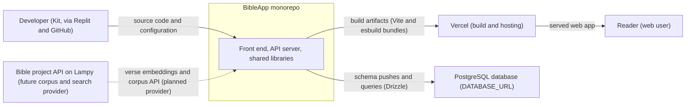
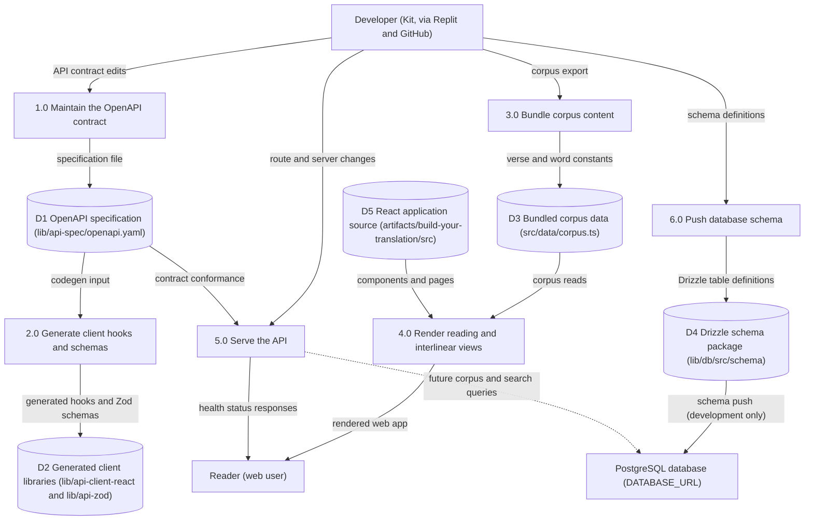
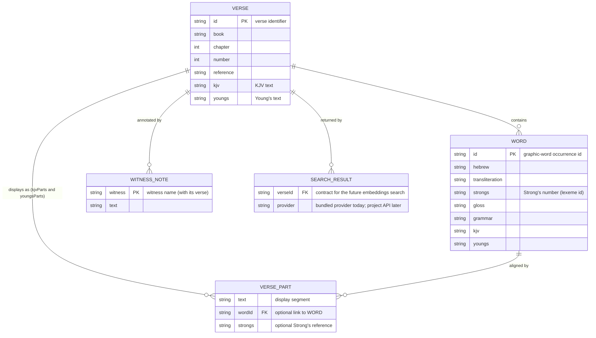

Living document — update these diagrams when adding features.
# BibleApp — Architecture

A pnpm-workspace TypeScript monorepo (scaffolded on Replit, 2026-11-03) for the "Build Your Translation" Bible app — a second front end over the Bible project's corpus, alongside BibleApp-pwa. It is at scaffold stage: the API surface is a health check only, the database schema package is an empty stub, and the reading UI runs on a bundled corpus data file whose interfaces are written as the contract for the project's future API. Deployment targets Vercel (Vite build) with Replit as the authoring environment.

Packages: `artifacts/api-server` (Express 5 API, esbuild CJS bundle, port 5000 in dev), `artifacts/build-your-translation` (Vite + React front end, wouter routing, TanStack Query), `artifacts/mockup-sandbox` (design mockups), `lib/api-spec` (OpenAPI 3.1 spec + Orval codegen), `lib/api-client-react` and `lib/api-zod` (generated client hooks and Zod schemas), `lib/db` (Drizzle ORM + PostgreSQL access; requires `DATABASE_URL`).

## Context diagram

## Level-1 DFD

## ER diagram

No persistent tables exist yet: `lib/db/src/schema/index.ts` is an empty export with template guidance only. The data model that exists today is the front end's TypeScript corpus model (`src/data/corpus.ts`), drawn below; it is the contract the future API provider must match.

## Grounding notes

- OBSERVED (repo tree, HEAD `c242a6e5` 2026-11-05): pnpm-workspace monorepo — artifacts/api-server, artifacts/build-your-translation, artifacts/mockup-sandbox; lib/api-client-react, lib/api-spec, lib/api-zod, lib/db; scripts/ package; `.replit` and `replit.md` present.
- OBSERVED (replit.md): stack is pnpm workspaces, Node.js 24, TypeScript 5.9, Express 5, PostgreSQL + Drizzle ORM, Zod v4, Orval codegen from the OpenAPI spec, esbuild CJS bundle; required env `DATABASE_URL`; API server dev port 5000.
- OBSERVED (lib/api-spec/openapi.yaml): the entire API contract is one operation — GET `/healthz` returning `HealthStatus{status}` — under base path `/api`.
- OBSERVED (artifacts/api-server/src/routes/): only `health.ts` is implemented; routes/index.ts wires it.
- OBSERVED (lib/db/src/schema/index.ts): `export {}` — no Drizzle tables are defined; the file is template guidance. The ERD therefore models the front-end corpus types, not a database.
- OBSERVED (artifacts/build-your-translation/src/data/corpus.ts): the bundled corpus is declared "the single source of corpus content"; Word ids identify graphic-word occurrences (Strong's identifies lexemes); VersePart arrays are explicit display-order alignments; Young's alignment is computed, not a published interlinear. Its SearchResult contract names the project's own future search engine: verse embeddings, nomic-embed-text, 768 dimensions, one vector per verse, served by the project's API — the bundled provider implements the same async contract.
- OBSERVED (artifacts/build-your-translation/src/App.tsx): the routed UI is still the scaffold (placeholder Home reading "Replit Agent is building...", plus a not-found page) — the corpus data layer is ahead of the pages.
- OBSERVED (commit c242a6e5): Vite env defaults (PORT, BASE_PATH) were added for Vercel builds — Vercel is the deployment target.
- INFERRED: the planned flow from the Bible project API (Lampy) into this app is drawn dotted — corpus.ts states the contract and the replacement point, but no API call exists in the code yet.
